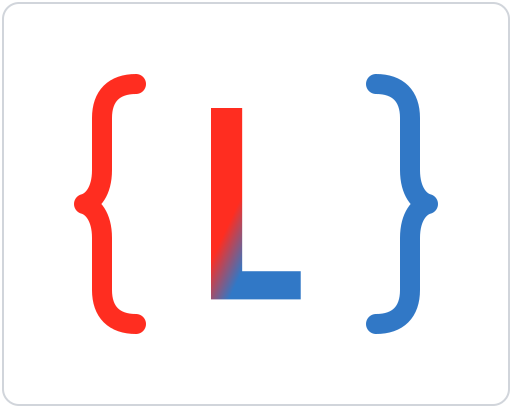

# Tolki JS

Use the PHP Laravel framework utilities in your JavaScript projects.

<p align="center"></p>

<p align="center">
    <a href="https://tolki.abe.dev"><strong>Documentation</strong></a> ·
    <a href="https://tolki.abe.dev/packages.html">Packages</a> ·
    <a href="./CONTRIBUTING.md">Contributing</a>
</p>

<p align="center">
    <a href="https://github.com/abetwothree/tolki/actions/workflows/ci.yml"></a>
    <a href="./LICENSE"></a>
</p>

## The Laravel helpers you know, in JavaScript

What you write in PHP:

```php
Str::headline('user_profile_settings'); // "User Profile Settings"

collect($users)->where('role', 'admin')->pluck('name')->all(); // ["Taylor"]

data_get($data, 'user.email', 'n/a'); // "n/a" when the key is missing
```

What you write in JavaScript or TypeScript with Tolki:

```ts
import { headline } from "@tolki/str";
import { collect } from "@tolki/collection";
import { dataGet } from "@tolki/data";

headline("user_profile_settings"); // "User Profile Settings"

collect(users).where("role", "admin").pluck("name").all(); // ["Taylor"]

dataGet(data, "user.email", "n/a"); // "n/a" when the key is missing
```

## Also By Me

- [Laravel TypeScript Publish Package](https://github.com/abetwothree/laravel-ts-publish)
- [Laravel Iconify API & Icon Rendering](https://github.com/abetwothree/laravel-iconify-api)

## Why Tolki JS

- **Behaves like Laravel.** Each function follows its Laravel counterpart, and its behavior is checked against the real framework ([parity transcripts](./docs/php-parity)). Where JavaScript can't match PHP, the docs say so for [arrays and objects](https://tolki.abe.dev/arrays-objects/differences.html) and [collections](https://tolki.abe.dev/collections/differences.html).
- **TypeScript first.** Written in TypeScript, with types for every function and for Laravel responses such as paginators and API resources.
- **Tree-shakeable.** Every package is side-effect free, so your bundle only keeps the functions you import.
- **Fully tested.** Every package has 100% test coverage.
- **No Laravel required.** Works in any JavaScript or TypeScript project, whether that's Vue, React, Svelte or Node.

## Installation

Install only the packages you need:

```bash
npm install @tolki/str
# or
pnpm add @tolki/str
# or
yarn add @tolki/str
```

## Packages

### Arrays, objects and collections

Not sure which one fits your data? See [Choosing a package](https://tolki.abe.dev/arrays-objects/#choosing-a-package).

| Package                                      | Description                                                                         | npm                                                                                                                                                                                                                                       |
| -------------------------------------------- | ----------------------------------------------------------------------------------- | ----------------------------------------------------------------------------------------------------------------------------------------------------------------------------------------------------------------------------------------- |
| [`@tolki/data`](./packages/data)             | `dataGet`, `dataPluck` and more, for data that may be an array, an object or a Map. | [](https://badge.fury.io/js/@tolki%2Fdata) [](https://www.npmjs.com/package/@tolki/data)                         |
| [`@tolki/collection`](./packages/collection) | Laravel's fluent `Collection` class.                                                | [](https://badge.fury.io/js/@tolki%2Fcollection) [](https://www.npmjs.com/package/@tolki/collection) |
| [`@tolki/arr`](./packages/arr)               | Laravel's `Arr` helpers for arrays.                                                 | [](https://badge.fury.io/js/@tolki%2Farr) [](https://www.npmjs.com/package/@tolki/arr)                             |
| [`@tolki/obj`](./packages/obj)               | Laravel's `Arr` helpers for plain objects.                                          | [](https://badge.fury.io/js/@tolki%2Fobj) [](https://www.npmjs.com/package/@tolki/obj)                             |

### Strings and numbers

| Package                        | Description                                                           | npm                                                                                                                                                                                                           |
| ------------------------------ | --------------------------------------------------------------------- | ------------------------------------------------------------------------------------------------------------------------------------------------------------------------------------------------------------- |
| [`@tolki/str`](./packages/str) | Laravel's `Str` helpers, plus the fluent `Stringable` through `of()`. | [](https://badge.fury.io/js/@tolki%2Fstr) [](https://www.npmjs.com/package/@tolki/str) |
| [`@tolki/num`](./packages/num) | Laravel's `Num` helpers, such as `format`, `currency` and `fileSize`. | [](https://badge.fury.io/js/@tolki%2Fnum) [](https://www.npmjs.com/package/@tolki/num) |

### TypeScript

| Package                            | Description                                                                                                                              | npm                                                                                                                                                                                                                   |
| ---------------------------------- | ---------------------------------------------------------------------------------------------------------------------------------------- | --------------------------------------------------------------------------------------------------------------------------------------------------------------------------------------------------------------------- |
| [`@tolki/types`](./packages/types) | Types for Laravel paginators, API resources and JSON:API responses.                                                                      | [](https://badge.fury.io/js/@tolki%2Ftypes) [](https://www.npmjs.com/package/@tolki/types) |
| [`@tolki/ts`](./packages/ts)       | Runtime helpers for the enums and routes that [Laravel TypeScript Publish](https://github.com/abetwothree/laravel-ts-publish) generates. | [](https://badge.fury.io/js/@tolki%2Fts) [](https://www.npmjs.com/package/@tolki/ts)             |
| [`@tolki/enum`](./packages/enum)   | PHP-style enum helpers: `from`, `tryFrom` and `cases`.                                                                                   | [](https://badge.fury.io/js/@tolki%2Fenum) [](https://www.npmjs.com/package/@tolki/enum)     |

## Backstory

I love [Laravel](https://laravel.com/). I love JavaScript [frontend frameworks](https://vuejs.org/). I love how [Inertia JS](https://inertiajs.com/) bridged the gap between these two worlds. I just wish I could use the incredible helper functions that Laravel provides in my JavaScript code with proper TypeScript support and tree-shaking capabilities.

After making them, I then decided to open-source these utilities so that others could benefit from them as well. Thus, the Tolki JS project was born. Read more in [Why Tolki JS?](https://tolki.abe.dev/why-tolki-js.html)

## Contributing

Contributions are welcome. See the [contributing guide](./CONTRIBUTING.md) to get set up, and please follow the [code of conduct](./CODE_OF_CONDUCT.md).

To report a security issue, follow the [security policy](./SECURITY.md) instead of opening a public issue.

## License

Tolki JS is open-source software licensed under the [MIT license](./LICENSE).
